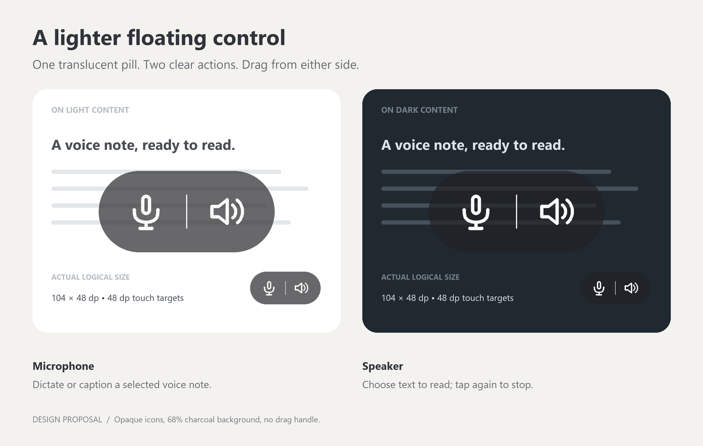

# Floating controls: translucent horizontal pill

Owner-approved design following 0.4.0 handset feedback. Implementation and handset acceptance are tracked below.

## Appearance

- One horizontal capsule, 104 × 48 dp, radius 24 dp. Two 48 × 48 dp touch targets with 4 dp of outer horizontal padding.
- Charcoal background (#202124) at 68% opacity. Icons remain solid off-white; do not fade the whole view. This is transparency, not a blur effect.
- Draw 24 dp microphone and speaker-with-two-sound-waves vector icons using consistent 2 dp rounded strokes. Do not use font emoji or platform button backgrounds.
- A faint 20 dp vertical separator distinguishes the two actions. No dedicated drag handle or ellipsis. No permanent text labels in the overlay.
- If only one action is enabled, collapse to a 48 dp circle with the same visual treatment.
- The preview uses enlarged and actual-size examples; dp ultimately scales with the handset's display density.

## Interaction

- Tap microphone: preserve existing dictation / selected voice-message caption routing.
- Tap speaker: preserve text picking; tapping again during picking, synthesis or playback cancels.
- Drag from either icon or the surrounding capsule. Reuse the existing PillLayout gesture threshold so a drag cancels the child click, and a slightly unsteady tap still activates it. Save the final position and clamp it to the display.
- Keep existing operation/status pills and all source, microphone, screen-lock and cancellation safeguards unchanged.
- Preserve focus-free accessibility-overlay behavior. Each action remains a separately labelled accessible button: Dictate / Read aloud or stop. The existing cancellation action remains available during synthesis and playback.
- Press feedback stays inside the capsule. Avoid idle animation, blinking or a persistent glow.

## Implementation / acceptance checklist

- [x] Replace the emoji buttons and handle in ReadAloudController with vector ImageButtons in a rounded translucent PillLayout.
- [x] Preserve read_mic/read_speaker tags, accessibility descriptions, enable/visibility rules and saved placement.
- [x] Update the Settings usage text and README's obsolete “Drag ⋮” instruction.
- [ ] Run Android lint, unit tests and debug assembly.
- [ ] On the handset, verify tap versus drag on both halves, no accidental activation after dragging, persistence and screen-edge clamping.
- [ ] Check readability over light/dark content and TalkBack labels; verify microphone-only Try context and hidden own-settings context.
- [ ] Confirm dictation start/Stop, caption routing and narration start/cancel still work. Do not use UIAutomator dumps during active operations on this handset.

The owner approved this proposal before implementation. Handset acceptance precedes another signed deployment. No new permissions, service endpoints or consent changes are needed for this design.
